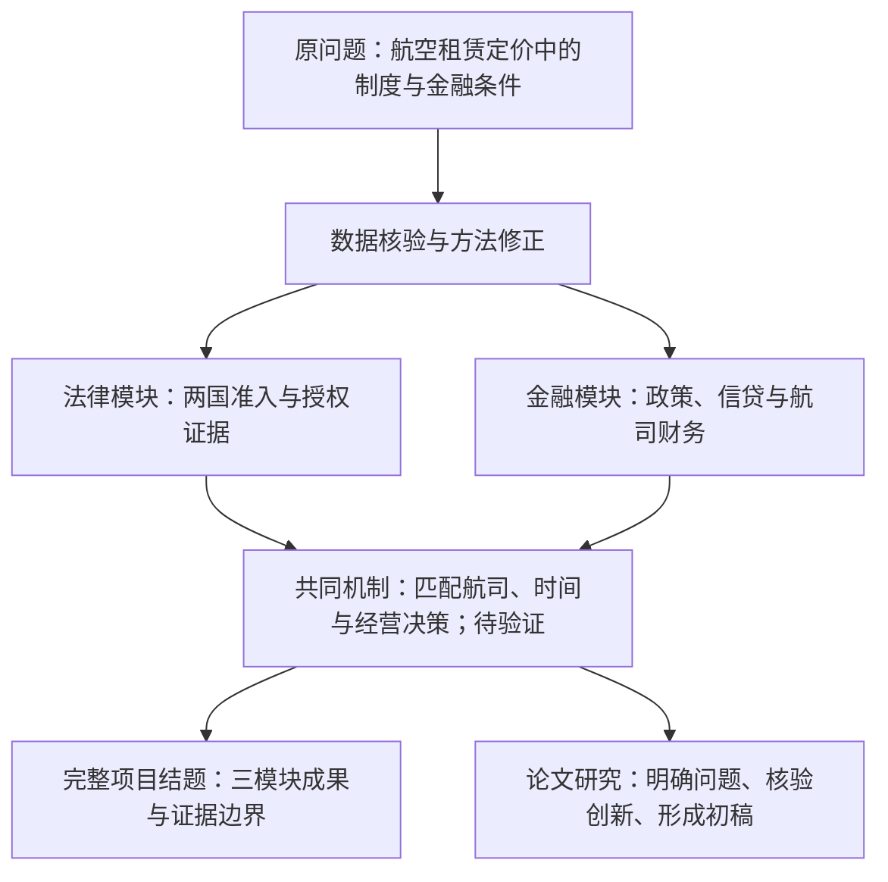

# 云程有数：西非法语区航空业的制度开放与金融约束研究

## 2026年10月28日中期答辩完整文字包

编制日期：2026年10月24日。用途：中期进展报告、12页PPT制作、5—7分钟答辩及质询准备。

本稿采用项目负责人最新确定的完整研究方向：法律制度、金融环境、综合机制三个模块并行。此前把整体项目收缩为纯法律比较的执行建议不再适用。法律比较仍是证据相对集中的研究模块，金融研究保留为实质成果，综合机制为待验证部分。

新题名是负责人确定的研究方向名称，学校正式更名批准状态尚未确认。学校系统、申报表等仍按正式登记名称填写，必要时加注“中期研究方向调整”。论文题目可根据最终证据和投稿范围另定，不必逐字等同于项目名称。

归档更新（2026-10-24）：已对照最新分支补入金融展示完成状态；最新复验30＋6项测试通过。浏览器验证沿用 `docs/verification_20261024_v3.md` 的记录，答辩电脑双击与投影验收仍待完成。以下研究数字未因展示更新而扩大。

### 使用与证据说明

- 本稿只整合现有材料，未开展新一轮广泛检索。数字来自仓库数据和重新计算，法律判断沿用已有原文核验记录，不表示本轮重新认证所有文件的现行效力。
- 核查版本：main `a5af45deba195e53debdefd74ee12de6fe3f21b2`；研究分支 `research/fifth-freedom-bj-sn-v3`，提交 `248c1bcd644085d8747eec877cae793b7a230428`。该研究分支的 `data/` 与上述main版本一致。
- 法律数据快照证据截止2026年10月19日；10月23日收录的法语组底稿单独归档，尚未作为独立核验结果并入主数据库。金融数据各有统计期和出版版本，不存在统一的“最新2026全年样本”。
- 本轮重新运行金融构建脚本，生成结果与仓库数据一致；30项常规测试和6项法律证据测试通过。测试只覆盖特定结构与计算，不认证法律效力、外部事实或因果结论。
- 下文方括号编号对应文末“来源与复现索引”。PPT建议在页脚保留简短来源和页码，完整链接放在备注中。

---

## A．项目研究历程与调整说明

### 1．研究问题的连续性

项目始终关注西非法语区航空企业面对的跨境制度与融资条件。原方案希望直接估计这些条件对飞机租赁资产价格的影响。实际研究中，宏观金融公开数据可以取得，微观租赁合同、残值和违约收回时间则缺少可核验的交易与案件记录。因此，研究对象从资产定价拓展为航空企业经营条件，同时保留金融与制度两条研究线。

调整不是简单替换标题或变量：原方案的资产定价因果识别，转为制度文本比较、融资数据描述、有限企业财务案例和机制分析。最终目标仍是解释航空业经营环境，但结论强度服从证据。

### 2．可核验的阶段记录

| 阶段 | 研究问题与工作 | 实际成果 | 调整原因与当前地位 |
|---|---|---|---|
| 原立项v1 | ECB利率、OHADA制度摩擦与航空租赁资产定价 | 原申报书、答辩材料；后续重建的租赁情景模型 | 缺真实交易租金、残值、合同敞口和案件执行时间。旧模型保留为假设演示 |
| 2026-10-15数据与方法整理 | 核验央行政策与区域融资条件，检查识别边界 | 81个月政策利率、26季度贷款数据、年度融资数据、版本审计及程序 | 公开金融数据可形成真实成果；“固定汇率必然同步加息”等原设定需要纠正 |
| 2026-10-16 v2 | 将航空企业净利润与收入纳入结果变量 | Air Côte d’Ivoire 2019—2023年5条公司年度记录、财务变量字典、可得性矩阵 | 企业样本不足，未形成多航司面板。净利润不能作为租赁价格的替代测量 |
| 2026-10-18至19日 v3法律补证 | 贝宁、塞内加尔准入制度、第五航权证据链 | 25项来源、9条核心法条、11条事件、18条航线审计记录、3条候选证据链、12项文献记录 | 第五航权个案许可和当地载运证据不完整；条件性推进制度与证据研究 |
| 2026-10-22至23日协作整理 | 数据、法语组底稿、展示与复现 | v3展示页及离线单页；法语组Markdown和比较CSV归档；代码检查 | 技术成果可展示，独立法律复核、现场浏览器验收和研究整合仍需继续 |
| 2026-10-24综合方向确认 | 《云程有数》三模块研究 | 本中期进展报告、12页内容、讲稿、问答与路线图 | 保留完整项目，明确法律、金融证据与综合机制之间的边界 |

依据：[P1—P3、G1—G3]。日期按现有研究记录及提交历史整理，不推断未记录的工作或访谈已经发生。

### 3．原方案需要公开纠正的内容

1. 原申报书把2024年ECB描述为持续加息。现有政策事件记录显示其在2024年6月转向降息，不能沿用原表述。[F1、P2]
2. XOF与欧元的固定汇率联系不意味着BCEAO政策利率逐次同步调整，是否同步应以两条实际时间序列判断。[F1、F2]
3. ECB利率对当地单家航司而言难以操纵，不足以证明它是有效工具变量。全球融资、汇率、燃油和需求等路径可能直接影响企业经营，排除限制尚未成立。[P2]
4. OHADA法律条款、司法效能指标与飞机实际收回月数是不同对象，不能直接换算。法国DGAC不能作为贝宁和塞内加尔国内民航主管机关的替代称谓。[P1、L1、L2]
5. 原租赁模型中的假设参数和计算租金不能作为市场报价。中期不声称完成2SLS、机型因果比较、专家访谈或企业内部数据采集。[P1—P3]

### 4．可提交给导师的调整理由

项目在数据核验后发现，原拟使用的微观租赁交易价格和法律执行时间尚无法获得可靠公开样本，航空企业财务信息也不足以支持原定因果识别。团队已完成ECB/BCEAO政策与区域信贷数据整理，并建立贝宁、塞内加尔航空市场准入证据库。现申请以“制度开放与金融约束”为整体框架，保留航空产业、法语原始资料和金融研究特色，采用制度比较、描述性统计和企业案例相结合的方法。该调整保留原课题的问题意识，实质修正研究对象、证据要求和方法，不将数据不足掩盖为已经验证的机制。正式名称、研究内容和预期成果调整请指导教师及学校按规定审核。

---

## B．中期研究进展报告

### 1．研究目标与三个问题

总目标：利用公开、低成本、可追溯的法语和英语资料，分析西非法语区航空企业所处的市场准入制度与融资环境，识别二者可能共同影响经营条件的机制和证据缺口。

**制度问题：** UEMOA、SAATM相关区域安排与贝宁、塞内加尔国内许可规则如何衔接？一般规则、具体批准与运营报告之间分别有什么证据？

**金融问题：** ECB、BCEAO政策利率与区域银行贷款价格如何变化？区域平均、国家平均和贷款类别之间是否呈现不同变化？现有航司财务资料显示什么经营变化？

**综合问题：** 市场准入机会在何种融资与经营条件下可能转化为航线投资和企业收益？目前证据能支持哪些环节，哪些仍需要企业或行政资料？

“金融约束”在本阶段是研究概念。现有利率主要刻画融资价格环境，尚未直接观测航司被拒贷、额度不足、债务契约或实际边际融资成本，不能声称已经测量完整的企业融资约束。

### 2．范围与分析单位

| 模块 | 主要范围 | 分析单位 | 使用边界 |
|---|---|---|---|
| 法律制度 | 贝宁、塞内加尔；UEMOA与SAATM制度背景 | 法条、政策文书、事件、具体航线证据链 | 法条存在与实际行政实施分开 |
| 金融环境 | ECB、BCEAO、UEMOA；已有塞内加尔、科特迪瓦贷款序列 | 月末政策利率、季度贷款均值、年度加权均值 | 区域银行数据不等于航空企业贷款数据 |
| 企业经营 | Air Côte d’Ivoire 2019—2023年 | 同一家企业的年度收入与净利润 | 是辅助企业案例，不是贝宁—塞内加尔绩效对照 |
| 综合研究 | 西非法语区航空企业经营条件 | 分层证据与待检验机制 | 尚未形成同国、同航司、同期间的法律—财务联合样本 |

贝宁与塞内加尔具有共同区域制度背景，有利于比较国内法律衔接方式。案例选择也受公开文件可得性影响，不能宣称代表全部非洲或已控制所有经济差异。科特迪瓦财务材料的加入延续已有金融成果，不扩大法律比较国家范围，也不能填补贝宁或塞内加尔航司财务缺口。

### 3．成果与数据数量

| 已有成果 | 数量及时间 | 数量的准确含义 | 状态 |
|---|---|---|---|
| ECB政策事件表 | 21条，含样本前初始状态 | 生效日期与DFR/MRO值，用于构建月末水平 | 已整理，可复算 |
| BCEAO政策事件表 | 10条，含样本前初始状态 | 最低投标与边际贷款工具记录 | 已整理，可复算 |
| 央行月末面板 | 81行，2020-01至2026-09 | 81个月份，每行含4个政策工具序列；不是81次冲击 | 已完成 |
| 连续贷款季度面板 | 26行，2020Q1至2026Q2 | UEMOA、科特迪瓦、塞内加尔3条贷款序列及2条季末政策序列 | 已完成；版本争议保留 |
| 年度融资表 | 6行×7个利率序列，2020—2025 | 42个序列年度值，不是42个独立企业 | 已完成 |
| 流动性招标月度表 | 21行，2024-07至2026-03 | 一周流动性注入操作的月度统计，非21次周度招标 | 已完成 |
| 航司财务表 | 1家公司×5年，2019—2023 | 5条记录，每条有收入与净利润；早期图示值有舍入 | 初步财务案例完成 |
| 航司财务可得性矩阵 | 4家×7年，共28个候选格 | 仅5格已有收入和净利润，余23格待核；不是28条有效财务观察 | 已建立检索台账 |
| 法律模块来源登记 | 25项 | 22项官方一手、2项航司一手、1项官方托管委托分析；并非25部法律 | 已登记，核验深度不一 |
| 政策事件 | 11条 | 编码事件，不等于11次已实施改革 | 已编码 |
| 核心法条 | 9条 | 贝宁224—227条、塞内加尔230—234条；另跟踪转引 | 初核完成，独立复核未完成 |
| 航线审计记录 | 18行 | 包含不同证据项与核查记录，不等于18条独立航线，更不等于已授权航线 | 已整理 |
| 候选证据链 | 3条 | KQ、Afrijet、Mauritanian候选链；均未闭合全部批准与载运证据 | 缺口明确 |
| 文献矩阵 | 12项 | 10项期刊记录、1本书、1份报告；不等于12篇全文精读 | 部分精读 |
| 自动检查 | 36项通过 | 30项常规测试与6项法律证据测试；不认证研究结论真伪 | 本轮复跑通过 |

来源：[F1—F6、L0、G1—G3]。原6季度短表和2026Q2版本表与26季度主面板存在重叠，保留用于版本审计，不相加扩大样本。8条控制变量来源计划也不计为已采集数据。

### 4．法律制度的初步发现

**发现一：两国一般准入要求均保留行政授权环节。** 贝宁224条针对外国航司往返贝宁的定期国际航线，塞内加尔231条规定外国公司国际航线的事先许可。一般授权框架的存在不能证明特定航司已经获批，也不能直接判为不符合开放承诺。[L1、L2]

**发现二：比较需要展开交叉引用。** 贝宁225条转引11、218、219、223条；塞内加尔232条转引224及226—229条。已取得文本显示二者连接的监管规则不同，单读许可条款会遗漏适用内容。但引用条数不能衡量监管强度、审批耗时或开放程度。[L1、L2、L0]

**发现三：国内运输保留与第五航权不能混用。** 贝宁227条同时涉及国际商业载运与国内运输；塞内加尔234条涉及国内运输保留，须连同230条对UEMOA规则的保留阅读。不能只比较国籍措辞，就认定某国更开放。[L1—L3]

**发现四：公开程序文件与法典存在时间衔接待核问题。** 贝宁AIP页面仍刊载1989年令，塞内加尔AIP刊载2004年命令及旧条号。现有证据支持继续追踪配套规则和机构权限，尚不足以认定旧规失效、法律冲突或监管违法。[L8、L9]

**发现五：第五航权证据链成熟度有限。** Kenya Airways 2022年报第31页报告Accra–Dakar于2022年12月11日开通、每周两班；AFCAC列有相关完整航程。肯尼亚—加纳协定提供部分法律依据。但塞内加尔端个案许可、当前协定连续性和当地付费载运仍未闭合，不能标为完整核实的第五航权行使。[L5—L7]

### 5．金融环境的实际发现

以下统一采用BCEAO 2025年度银行条件报告版本；单位为年化百分比，变化单位为基点，1个百分点=100基点。[F3]

| 系列 | 2024 | 2025 | 变化（bp） |
|---|---:|---:|---:|
| UEMOA全部贷款 | 6.76% | 6.69% | −7 |
| 科特迪瓦全部贷款 | 6.45% | 6.26% | −19 |
| 塞内加尔全部贷款 | 5.93% | 5.98% | +5 |
| UEMOA非金融企业贷款 | 6.34% | 6.45% | +11 |
| UEMOA设备贷款 | 7.04% | 7.06% | +2 |
| UEMOA出口贷款 | 6.51% | 6.79% | +28 |
| UEMOA营运资金贷款 | 6.38% | 6.44% | +6 |

**可支持：** 区域平均融资价格下降时，某些国别或用途类别可以同时上升。各项采用不同借款人或贷款构成，不能将差异直接解释成相同贷款产品的国家风险差价，也不能由此推断航司融资成本。

26季度主面板中，UEMOA平均贷款利率从2024Q3的7.07%降至2026Q2的6.67%，端点相差40bp；后者在所用公报中为暂定值。中间有波动，不能称持续单调下降。[F4]

21个月的流动性注入操作加权利率从2024年7月5.5%降至2026年3月3.577%，端点变化−192.3bp。这是央行向银行投放流动性的成交条件，不是银行间拆借或航空企业贷款利率，不能与另一频率端点相除构造“传导系数”。[F5]

已有探索性季度变化相关分析。例如ECB DFR与BCEAO TMS同季变动相关系数约0.542（25个差分观察）；BCEAO与塞内加尔贷款变动同季相关约0.091（排除版本争议影响后23个观察）。这些数字不作显著性、因果或预测性能判断，中期主讲页不以相关系数排名作为发现。[F4、P3]

### 6．航空企业财务案例

Air Côte d’Ivoire公开报告记录如下。金额单位为十亿XOF，利润率由仓库数值计算，四舍五入至两位小数。[F6]

| 年份 | 营业收入 | 净利润 | 净利润率 | 精度说明 |
|---|---:|---:|---:|---|
| 2019 | 109.30 | −7.33 | −6.71% | 官方图示舍入值 |
| 2020 | 47.60 | −26.80 | −56.30% | 官方图示舍入值 |
| 2021 | 78.60 | −9.01 | −11.46% | 官方图示舍入值 |
| 2022 | 113.50 | −0.93476 | −0.82% | 收入图示值；净利润按仓库记录的正文精度 |
| 2023 | 128.94 | +0.65767 | +0.51% | 正文披露金额 |

**可支持：** 现有报告显示该公司收入在2020年较低，之后回升，2023年净利润转为小幅正值。**不能支持：** 这一变化由ECB利率、第五航权或贝宁/塞内加尔法律调整造成。2023年还早于贝宁2024年法典，不能建立其改革后的绩效比较。

数据来自官方国有资产组合报告，不是已取得的逐年独立审计财务报表。具体财年结束日、完整会计范围及政府支持的会计确认仍待核。仓库2022年备注另提DGPE 2023报告正文精度，正式投稿前需补足对应版本定位。不能把政府注资直接计入营业收入或机械从净利润中扣除。

### 7．综合研究：已有材料与机制假说

现有材料支持把“进入市场的制度条件”与“投入运营的融资条件”同时纳入研究框架，尚未证明二者的联合效果。

| 可能机制 | 现有支持 | 尚缺的关键证据 | 本阶段表达 |
|---|---|---|---|
| 准入机会扩大可经营航线范围 | 一般准入规则、候选航线报告 | 个案批准、可销售航段、航线时序与需求 | 待检验的市场机会机制 |
| 融资成本或额度影响机队与航线投入 | 区域信贷价格及有限航司财务记录 | 航司实际贷款、租赁负担、币种敞口、拒贷/额度数据 | 融资环境可能构成约束 |
| 许可时间不确定性影响资金占用 | 程序与配套材料衔接问题 | 实际申请日期、批准耗时、延误成本 | 尚未测量的行政—金融机制 |
| 市场准入与融资条件共同影响盈利 | 两类证据已建立 | 同航司、同期间、同市场的匹配记录及混杂因素 | 不能量化联合效应或交互系数 |

后续综合研究应优先寻找少量可核实的“同一航司经营决策”证据，而非把宏观利率直接复制到每一条法律记录上。无法取得匹配资料时，最终项目仍可报告两个模块的真实发现及机制边界，但不能把机制图写成实证结果。

### 8．创新候选点

| 候选点 | 已有基础 | 需要完成的增量 | 当前成熟度 |
|---|---|---|---|
| 法语原始文本的准入规则与交叉引用比较 | 9条法条矩阵、区域规则、程序来源 | 对关键转引和配套规则独立复核，形成适用对象清晰的解释 | 最接近形成论文贡献，但尚待文献与法律复核 |
| 承诺、规则、许可、运营的可追溯证据编码 | 25项来源、3条候选链、缺失状态 | 对照已有AFCAC指标说明新增的条款级与证据链信息 | 有数据整理价值，不能仅以分层概念声称首创 |
| 制度证据与融资价格版本审计并列呈现 | 金融多频率数据、修订记录、企业案例 | 在明确单位与时间的条件下连接经营机制 | 综合研究候选贡献，尚未验证联合效应 |

Njoya（2016）已经讨论非洲航空自由化与实施障碍，不能声称首次发现“承诺与落实有差距”。Shirichena（2026）仍未获得全文，暂不能断言研究与其完全不同。12项文献记录不等于完成系统综述。[R1、R2]

### 9．关键缺口与风险

最关键的三个缺口是：①具体授权与当地载运证据；②航司实际融资及可比财务数据；③关键法律现行性、配套规则和最近论文全文。第一项限制第五航权实施结论，第二项限制综合机制实证，第三项限制法律解释与创新确认。

这些缺口不妨碍真实汇报中期成果，但阻止我们声称完成航空企业因果识别或已达到投稿标准。BCEAO跨版本差异也必须保留：2025年度区域平均在年报为6.69%，另一季度出版物列6.73%，原因尚未解决；2025Q1国别回溯值存在较大差异。主讲使用统一年度报告口径，季度图使用选定版本并标注争议期。[F3、F4]

### 10．阶段评价

**已完成：** 数据整理、来源记录、描述统计、核心法律初核、证据链缺口表、可复现代码及技术展示。

**初步判断：** 两国准入制度具有可比较结构；区域融资价格变化具有异质性；公司财务可形成有限案例；三模块适合作为整体项目框架。

**尚待验证：** 现行配套规则、具体第五航权批准、航司融资约束、制度与金融共同作用、充分原创性及最终投稿匹配。

整体研究继续推进。中期答辩交付有充分的实际工作基础；完整论文仍为CONDITIONAL GO。该状态针对证据成熟度，不代表恢复原来的纯法律项目范围。

---

## C．12页答辩PPT逐页内容

总时长建议6分30秒，可压缩至5分钟。以下“主要文字”可以放在页内，“演讲备注”放备注区。表格和图表按提供的原始数据制作，不用模拟数值补齐空白。第5—7页重点展示法律，第8—9页展示金融和企业结果。

### 第1页｜云程有数：西非法语区航空业的制度开放与金融约束研究

**主要文字**
- 本科创新训练项目中期进展
- 制度准入、融资环境与航空企业经营条件
- 汇报人：郝悦嘉〔按学校登记姓名核对〕
- 日期：2026年10月28日
- 页脚小字：新研究方向；正式项目更名按学校审批结果办理

**建议图表：** 简洁封面，不放未经证实的飞机商业落地照片。可用三个研究模块的文字标签。

**实际来源：** 本轮负责人研究方向指令、原申报书[P1]。

**演讲备注（15秒）：** 本项目研究西非法语区航空企业的制度与融资环境。本次汇报主要介绍已形成的数据、法律比较结果，以及向完整研究推进时仍需解决的证据问题。

### 第2页｜研究历程与调整依据

**主要文字**
- 原立项：利率冲击、制度摩擦与租赁资产定价。
- v2：纳入航空企业收入与净利润，取得1家公司5年记录。
- v3：形成贝宁、塞内加尔准入法律与第五航权证据库。
- 当前：法律、金融和综合机制并行，结论服从数据覆盖。

**建议图表：** 四阶段时间轴。每阶段下方仅列一个成果和一个瓶颈。

**实际来源：** 原申报书、`docs/research_log.md`、v2调整记录、法律备忘录[P1—P3、L0]。

**演讲备注（35秒）：** 方向调整由资料核验推动。租赁交易数据不足，净利润样本也未形成企业面板。已积累的金融数据继续作为核心成果，法律材料提供制度层面的证据，两条线共同服务于航空企业经营条件研究。

### 第3页｜三个研究模块与证据范围

**主要文字**
- 法律：贝宁、塞内加尔准入规则及区域制度衔接。
- 金融：ECB/BCEAO利率、区域融资价格与有限航司财务案例。
- 综合：考察制度机会与融资条件共同影响经营的可能机制。
- 尚未形成同一企业、同一期间的法律—财务联合样本。

**建议图表：** 使用F部分路线图的研究模块部分。标出法律比较两国、金融区域样本、科特迪瓦企业案例各自范围；机制连线用虚线。

**实际来源：** [F1—F6、L0]；综合关系标“研究假说”。

**演讲备注（30秒）：** 法律与金融的样本范围并不完全重叠。我们明确区分国家制度、区域信贷和公司财务三个层次，避免把不同层次的数据强行合并为企业效果。

### 第4页｜已形成的可复核成果

**主要文字**
- 金融：81个月政策利率、26季度贷款利率、6年7组年度融资指标。
- 企业：1家航司5年收入与净利润。
- 法律：25项来源、9条核心法条、11条政策事件。
- 航线：18条审计记录、3条候选证据链。
- 复现：来源、脚本与输出保留版本，35项测试通过。

**建议图表：** 两栏清单；底部单列“18条为审计记录，不是18条已授权航线”。不要把不同单位总计成“样本量”。

**实际来源：** [F1—F6、L0、G1—G3]；本轮复算记录。

**演讲备注（30秒）：** 数据数量按不同单位报告。25项来源不是25部法律，26季度也不是26条航司财务记录。程序可以重建表格，但法律现行性和研究解释仍需人工审核。

### 第5页｜两国准入规则的逐条比较

**主要文字及建议表格**

| 比较维度 | 贝宁2024法典 | 塞内加尔2015法典 |
|---|---|---|
| 事先许可 | 224条，外国定期国际航线 | 231条，外国公司国际航线 |
| 持续监管 | 225条，转引11、218、219、223 | 232条，转引224、226—229 |
| 资料提交 | 226条，按现行法规 | 233条，条件由法令规定 |
| 载运与区域规则 | 227条，区分国际与国内运输 | 230条区域规则保留；234条国内运输 |

- 初步发现：一般准入要求相近，交叉引用与区域规则衔接需分别核查。
- 不据此排列国家开放程度或推断审批速度。

**建议图表：** 使用上述4行表，字体不低于可读字号；详细9条表放备查附件。

**实际来源：** [L1]公布稿PDF第56页及转引页；[L2]官方HTML第230—234条；[L3]第3、5、6条。

**演讲备注（45秒）：** 核心工作是把法语条款转化为可复查的比较。两国均保留许可与监督程序。差别不仅在单条措辞，还在转引和区域法保留。贝宁227与塞内加尔234不能直接用来比较第五航权，因为其中涉及国内运输。

### 第6页｜法律承诺到实际运营的证据层次

**主要文字**
- 政策承诺：是否宣布参与开放安排。
- 法律依据：区域规则、国内法或协定是否提供适用依据。
- 国内程序：申请主体、主管机关、资料要求与配套规则。
- 个案授权：是否取得指定及许可文件。
- 运营证据：是否允许当地商业载运，是否有可核实的运营记录。
- 缺失保留“未知”，不自动编码为未实施。

**建议图表：** 五行证据表。注明“不同证明问题，不是必然顺序或自动升级评分”。国内运输、第七航权等不混入第五航权案例。

**实际来源：** 编码手册[L0]、亚穆苏克罗决定第3及6条[L4]、区域规则[L3]。

**演讲备注（35秒）：** 第五航权要识别承运人所属国、与本国相连的完整服务，以及两个外国市场间的商业载运权。只有航线经过或报告开航不够。未知意味着公开证据尚未闭合，不等于实际没有运行。

### 第7页｜Kenya Airways候选案例的证据与缺口

**主要文字**
- 完整航程：Nairobi–Accra–Dakar；候选外国航段为Accra–Dakar。
- 航司年报报告：2022年12月11日开通，每周两班。
- AFCAC报告提供完整航程线索。
- 肯尼亚—加纳协定提供部分第五航权法律依据。
- 未取得：塞内加尔端具体许可、当地付费载运证据等。

**建议图表：** 上方三机场示意；下方“已取得/仍缺失”两列。结论写“报告层面交叉印证，授权链尚未闭合”。

**实际来源：** Kenya Airways 2022年报第31页[L6]；AFCAC 2023进展材料[L5]；肯尼亚—加纳协定第II、III、XXIV条及附件1[L7]。

**演讲备注（40秒）：** 这是当前材料相对完整的候选链。加纳侧协定不能代替塞内加尔批准。我们能够展示开航报告与部分规则依据，但不把它写成完整验证的第五航权实施，也不推断2026年仍在运营。

### 第8页｜区域融资价格的变化并不一致

**主要文字**
- 2024—2025年，UEMOA全部贷款平均利率：6.76%降至6.69%。
- 同期塞内加尔全部贷款：5.93%升至5.98%。
- 区域非金融企业贷款：6.34%升至6.45%。
- 融资环境存在不同变化，尚不能推断航空企业的实际融资负担。

**建议图表：** 三组配对点图；左侧两组为区域/国家全部贷款，右侧单列“非金融企业类别”，注明统计母体不同。可按B部分完整7组表扩展备查图。单位：年化%；同一年度报告版本。

**实际来源：** BCEAO 2025年度银行条件报告第34、62页；`bceao_annual_lending_2020_2025.csv`及构建脚本[F3]。

**演讲备注（40秒）：** 金融模块已经形成实际描述结果。区域平均下降，与特定国家或借款人类别上升可以同时发生。这说明研究经营条件时，不能只看央行政策方向或区域总均值，但还不足以证明某家航司融资受到怎样的约束。

### 第9页｜航空企业财务案例与样本边界

**主要文字**
- Air Côte d’Ivoire，2019—2023年5个年度。
- 营业收入：2020年47.60，2023年128.94，单位十亿XOF。
- 净利润：2020年−26.80，2023年+0.65767，单位十亿XOF。
- 2023年按披露金额计算净利润率约0.51%。
- 仅作企业描述案例，不构成贝宁—塞内加尔绩效对照。

**建议图表：** 上下两个共用年份轴的图：收入折线、净利润柱形。用B部分5年表，不使用双轴掩盖量级差异。图注注明早期舍入值、审计状态未独立确认。

**实际来源：** DGPE《2023—2024国家资产组合管理年度报告》第151页及财务精度记录[F6]。

**演讲备注（35秒）：** 当前财务数据来自官方报告，覆盖一家航司五年。可以说明收入和利润的变化，但不能分离疫情、需求、政府支持、航油和利率的作用。科特迪瓦案例也不能替代贝宁或塞内加尔企业样本。

### 第10页｜制度与金融共同作用的待检验机制

**主要文字**
- 制度条件影响可进入的市场、许可程序和合规要求。
- 融资条件可能影响机队投入、营运资金与航线维持能力。
- 两者共同作用于经营决策的关系尚未量化。
- 下一步优先取得同一航司、同一时期的许可与财务资料。

**建议图表：** 两个输入框“制度准入”“融资条件”，虚线汇入“航线与机队经营决策”，再虚线连接“收入、成本与利润”。底部标“机制假说，未完成因果检验”；需求、航油、政府支持放旁注作为可能混杂因素。

**实际来源：** 法律与金融数据库[L0、F1—F6]；机制为本研究待验证命题。

**演讲备注（35秒）：** 开放提供市场机会，企业能否投入和维持经营还可能受融资条件影响。当前法律与金融证据尚未在同一企业上闭合，因此我们提出具体补证方向，不报告联合效应的大小或因果系数。

### 第11页｜创新候选点与研究限度

**主要文字**
- 候选贡献：法语法条转引比较、可追溯证据链、融资数据版本审计及经营机制框架。
- 现有研究已经讨论自由化与实施障碍，不能声称首次提出。
- 关键缺口：具体许可、航司融资与财务、法律现行性及最新文献全文。
- GitHub提供复现与审计，不能替代学术和法律审核。

**建议图表：** 三行“候选贡献—已有材料—仍需验证”表，直接使用B部分创新表的简版。

**实际来源：** [L0、F4、R1、R2、G1—G3]。

**演讲备注（30秒）：** 创新应建立在具体新增证据上。我们已读到的研究讨论过一般实施障碍，最近一篇直接相关论文仍缺全文。因此中期只报告候选贡献，不预先宣布研究已经具有独立投稿创新。

### 第12页｜下一阶段与预期成果

**主要文字**
- 答辩前：冻结数据，核对展示条款，完成离线演示与计时排练。
- 法律线：复核配套规则、授权链与最近文献。
- 金融线：审核财务口径与版本，定向补企业经营资料。
- 综合线：在可匹配证据范围内形成机制分析。
- 并行成果：完整项目结题报告；范围适当、证据充分的英文或法文论文初稿。

**建议图表：** F部分任务表压缩为“答辩前/答辩后两周/答辩后一个月”三段。论文投稿与录用不写成确定日期。

**实际来源：** 本研究后续计划、现有缺口表；正式结题日期以学校要求为准。

**演讲备注（20秒）：** 下一阶段保持法律和金融两条研究线，并补足共同机制所需资料。项目结题呈现完整三模块，论文根据证据选择适当篇幅和问题，不以赶进度替代核验。

---

## D．约5—7分钟中文答辩讲稿

建议以正常、清晰语速朗读，实测时长后调整。页码提示不读出。若学院限5分钟，可删去第4段的辅助数量、第8段后半句与第11段文献细节，保留法律案例及金融两页。

【第1页】各位老师好。本项目现阶段的研究方向是《云程有数：西非法语区航空业的制度开放与金融约束研究》。我们关注航空企业进入市场需要满足什么制度条件，以及融资环境如何可能影响其经营。今天汇报已完成的成果、初步发现和下一阶段工作。

【第2页】原立项计划研究欧央行利率冲击、制度摩擦与航空租赁资产定价。实际核验后，我们发现公开资料不足以提供可靠的租赁合同价格、残值和司法收回时间。随后，我们转向企业收入和净利润，取得一家航空公司五年的记录，但仍不足以建立多企业面板。同时，团队整理了贝宁和塞内加尔航空准入法律。现在将这些工作纳入法律、金融和综合机制三个模块，保留原课题的跨学科主线，同时修正无法由数据支持的识别方法。

【第3页】三个模块的范围有所区别。法律比较聚焦贝宁和塞内加尔。金融研究覆盖欧央行、西非央行与区域贷款条件。现有企业财务案例来自科特迪瓦。我们不会把这些不同层次的记录直接拼成企业效果，而是先分别回答制度准入、融资价格和经营变化的问题，再寻找可以连接它们的证据。

【第4页】目前已完成八十一个月的政策利率数据、二十六个季度的贷款利率数据，以及六年七组年度融资指标。企业财务覆盖一家航司五年。法律模块登记二十五项来源，比较九条核心法条，并建立十一条政策事件和三条候选航线证据链。其中十八行航线材料是审计记录，不能理解为十八条已授权航线。数据能够通过脚本重建，本轮三十五项测试通过，但程序检查不替代原文和法律效力审核。

【第5页】法律研究的第一项发现是，两国一般准入制度均包含事先许可和持续监督。贝宁第二百二十四条明确涉及外国定期国际航线，塞内加尔第二百三十一条规定外国公司国际航线的事先许可。更重要的是，两国后续条文转引了不同监管规则。因此，我们展开交叉引用，而不是只比较一句许可要求。涉及国内运输保留的条款，还必须结合UEMOA规则阅读，不能直接作为第五航权开放程度的排名依据。

【第6页】我们把政策承诺、法律依据、国内程序、个案授权和运营证据分别记录。第五航权需要识别承运人所属国家、完整航程，以及两个外国市场间的商业载运权。一般法律允许、航线经过、航司报告开航，证明的是不同问题。没有取得公开文件时，我们保留未知状态，不推断政策没有实施。

【第7页】例如Kenya Airways的Nairobi、Accra、Dakar航程。航司年报报告Accra至Dakar于二〇二二年十二月十一日开通，每周两班，AFCAC也列有相关航程。我们还取得肯尼亚与加纳协定的部分法律依据。但加纳侧协定不能代替塞内加尔端的个案许可，当地付费载运证据也未闭合。因此，该案例支持开航报告的交叉印证，暂不支持完整验证第五航权实际行使。

【第8页】金融模块已经形成可以展示的描述结果。根据同一版本的BCEAO年度报告，二〇二四至二〇二五年，区域全部贷款平均利率从百分之六点七六降至六点六九。同期塞内加尔平均贷款利率小幅上升，区域非金融企业贷款利率也从百分之六点三四升至六点四五。这表明区域总均值与不同国家、贷款类别的变化可能不同。不过，各项统计构成有差别，也不能直接当作航空企业实际贷款价格。

【第9页】企业层面，Air Côte d’Ivoire的公开报告显示，收入在二〇二〇年下降后回升，二〇二三年净利润转为小幅正值，按披露金额计算的净利润率约为百分之零点五一。我们保留原值、单位和精度说明。这些资料可以形成企业经营描述，但无法把变化归因于利率或第五航权，因为需求、燃油、政府支持等因素尚未被分离。

【第10页】综合研究提出的机制是，准入规则影响企业可进入的市场，融资条件可能影响机队投入、营运资金与航线维持能力，两者共同影响经营决策。目前这仍是待检验机制。下一步需要同一航司、同一时期的批准记录和财务资料，而不是把区域平均利率机械套在每一条航线上。

【第11页】现阶段的候选贡献包括法语法条转引比较、分层证据链，以及融资数据的版本审计。已有文献讨论过非洲航空自由化的实施问题，所以不能把一般性的实施缺口当作首创。我们还需要取得最近相关论文全文，复核法律现行性和配套程序。GitHub的价值在于结论可以追溯到来源，计算可以重复，未知和修订也能够保留。

【第12页】答辩后，法律线继续补许可和程序证据，金融线继续核对企业财务与融资口径，综合线在可匹配资料范围内分析经营机制。项目结题保留完整三模块，论文则依据证据形成适当范围的英文或法文初稿。我们希望最终交付真实、可复查、有明确边界的研究成果。谢谢各位老师。

---

## E．评委可能追问的22个问题与回答

### 1．为什么研究题目变化这么大？
原方案的资产定价需要交易级租金、残值及执行时间，这些数据没有形成可靠公开样本。我们保留法语区航空、制度和金融主线，把研究对象调整为市场准入与经营条件。方法也相应改变，属于实质研究调整，需向导师和学校说明，不能说只是改了几个字。[P1—P3]

### 2．原立项是不是失败了？
原定资产价格因果识别尚未实现，这一点应如实承认。但资料核验产生了真实的央行与融资数据库、方法边界修正、法律证据库和可复现代码。中期成果包含发现原方案不可行环节并提出有证据基础的调整，而不是把未完成模型包装成结果。[F1—F6、L0]

### 3．金融到底在哪里？
金融模块包括政策利率、区域贷款价格、流动性操作与企业收入和净利润，已形成多频率数据及描述分析。例如2024—2025年区域全部贷款均值下降7bp，而非金融企业类别上升11bp。它是实质研究模块，但还未测到航司自身的边际融资成本。[F3]

### 4．为什么用“金融约束”，你们测量到了吗？
目前测量到的是融资价格环境，以及有限企业财务结果。融资约束还包括信贷配给、抵押、币种敞口和期限等，目前尚缺直接数据。因此“金融约束”是整体研究问题，现阶段不声称已经估计企业融资约束指数。论文中可以使用更严格的“融资环境与潜在约束”表述。[F1—F6]

### 5．法律和金融会不会只是两份报告拼在一起？
目前两类证据确实尚未在企业层面闭合，这是需要解决的核心问题。我们提出具体连接机制，例如准入机会与机队融资、许可时间与资金占用，并列出每个机制所需记录。后续若取不到同一案例证据，就保留为机制讨论，不声称联合效果已经验证。[B部分第7节]

### 6．为什么选择贝宁和塞内加尔？
两国处于共同UEMOA区域制度背景，可以比较国内法如何衔接区域规则。现有公开法典提供可逐条分析的材料。不过它们的市场规模和企业结构并不相同，选择也受文件可得性影响，所以这是有边界的比较案例，不是代表非洲的随机样本。[L1—L3]

### 7．为什么财务数据来自科特迪瓦？
这是前期已经取得、来源明确的公司财务案例。它用于展示同一区域航空企业的经营数据可得性和变化，不能替代贝宁或塞内加尔企业绩效，也不能直接验证两国法律的效果。我们明确保留这个范围差异。[F6]

### 8．第五航权到底是什么？
在与承运人本国相联系的国际服务中，承运人可以在两个外国市场之间进行商业载运的权利，是这里核查的第五航权。完整航程、承运国和当地上下客货权都要核实。普通第三、第四航权、国内两点间运输和仅技术经停不能混为一谈。[L4、L7]

### 9．十八条航线都有授权吗？
没有。数据库是18行航线审计材料，包含不同来源或证据项，不等于18条独立航线。当前详细整理了3条候选证据链，具体许可和当地载运证据仍有缺失。[L0]

### 10．没有找到批准文件，怎么还能研究？
可以研究一般规则、国内程序和公开证据的覆盖情况，也可以报告航司与官方机构的运营陈述。但不能把缺失解释为未批准或未实施。个案实施效果分析需要补足许可及实际商业载运资料。[L0、L5—L7]

### 11．KQ已经飞了，还不能认定第五航权吗？
航司报告与AFCAC材料支持开航陈述，但我们还没有完整核实当地付费承运权和具体许可。论文需要清楚说明证据层级。可以写“报告所列的第五航权候选案例”，不能把开航报告当作批准文件，也不能据此确认目前仍在飞。[L5—L7]

### 12．是不是贝宁比塞内加尔更开放？
现有材料不足以排名。两国相关条款的措辞与转引不同，但塞内加尔230条保留UEMOA规则的适用，必须与234条共同理解。审批条件、实际处理时间和获批情况也未完整取得。[L1—L3]

### 13．创新是什么，前人没有研究过吗？
前人已经研究非洲航空自由化、第五航权和实施障碍。我们的候选增量是更新后的贝宁法典与塞内加尔制度的具体转引比较、逐条证据链，以及与融资环境的审慎连接。最近论文全文尚未全部取得，因此不宣称首次，也不保证现有框架已达到期刊创新门槛。[R1、R2]

### 14．为什么不直接做回归？
公司财务只有一家五年，不足以支撑多变量企业因果分析。26季度是区域银行利率，不是航司利润观察；法律条文也不是可直接回归的连续企业指标。当前使用描述统计和比较案例，后续在单位、覆盖和识别条件满足后才讨论模型。[P2、P3]

### 15．ECB为什么不能直接作为工具变量？
工具变量不仅要与解释变量有关，还需要满足排除限制等条件。ECB变化可能通过全球融资、汇率和需求等多条路径影响航司，不能只因航司无法操纵ECB就判定有效。现阶段没有完成政策意外冲击或有效工具变量识别。[P2、P3]

### 16．金融数字前后不一致，是不是数据错了？
有些差异来自不同官方出版版本或统计口径，原因未必已经解决。我们保留版本并选定主口径。例如2025年区域年均利率，年度报告为6.69%，另一季度出版物为6.73%；主讲使用年度报告，不能把两个数字静默拼接。2025Q1国别版本差异也在审计中列明。[F3、F4]

### 17．净利润数据是否经过审计？
资料来自DGPE官方报告，但我们尚未取得并核对逐年独立审计财务报表。2019—2021年为图示舍入值，之后部分值采用正文精度。财年日、会计范围和政府支持会计处理仍需确认。可以展示披露值，不能声称完成审计。[F6]

### 18．旧版租赁模型能说明什么？
它在设定的利率、违约和回收时间假设下计算收支平衡租金，用于说明模型关系。没有真实租赁合同校准，不能当市场报价、估值结果或实证因果效应。本次主讲不以它作为核心发现。[P1—P3]

### 19．GitHub成果真实吗？怎么现场验证？
现场选一条结论回溯即可。例如打开年度融资CSV中的2024、2025行，查看来源页码，运行构建脚本，复算区域变化−7bp；再打开法律矩阵定位贝宁224条及PDF第56页。提交历史证明工作版本可追踪，程序检查证明特定输出可重复，但不能代替原始材料的真实性审核。[G1—G3、F3、L1]

### 20．AI做了多少？你本人贡献是什么？
如实说明AI用于资料定位、结构化、代码与文字辅助；组员提交展示开发和法语比较底稿；负责人统筹研究问题、核对关键来源、审核解释并承担最终结论责任。本人尚未完成的核验不能说已亲自完成。答辩前应亲自核对至少两个法条例子、一组金融数字和KQ报告定位。[G2、G3]

### 21．最终如何形成论文？还会再缩成纯法律吗？
项目结题保持法律、金融与综合机制三个模块。论文先围绕一个明确的问题组织证据，例如“区域制度与融资环境下的航空企业市场进入条件”。若企业匹配证据不足，需与导师讨论论文中机制分析的限度或成果组织方式，不能为了覆盖三个模块强写因果模型。论文与项目题名可以不同，整体项目范围不因此自动缩减。[本轮研究方向、B部分]

### 22．与中国航空产业有什么联系？
可用于提示进入西非市场时需要分别核查运营人准入、许可与融资条件，但目前没有中国企业进入效果的直接样本。非洲合资格承运人的区域权利不能自动推广给中国航空公司，制造商销售、租赁融资与航空运营许可也应分别讨论。中期只作审慎的研究启示，不作中国机型市场表现结论。[L3、L4]

---

## F．研究路线图与已完成／未完成任务表

### 1．研究路线图

下图连线表示研究工作流。“共同机制”是待验证分析，不代表已经识别的因果关系。



PPT排版替代：第一行“原问题与数据核验”，第二行并列“法律模块”“金融模块”，第三行“综合机制待验证”，第四行并列“项目结题”“论文研究”。第3行的机制关系用虚线，避免视觉上暗示因果已经成立。

### 2．任务状态与分工

工作量为执行估计，不是已经投入的工时；负责人按实际人员分配。P0为答辩前必做，P1为近期研究关键工作，P2为后续扩展。

| 任务 | 状态（截至本稿） | 优先级 | 预计剩余工作量 | 依赖与建议责任 |
|---|---|---|---|---|
| 金融源数据、81月与26季面板 | 已完成，重建一致 | P0维护 | 0.5小时冻结版本 | 数据/CS组 |
| 年度融资统计及版本审计 | 已完成；差异原因部分未解 | P0 | 1小时核对展示值 | 金融组；使用指定版本 |
| 企业收入净利润描述 | 5条记录已完成；审计范围待核 | P0 | 1小时核对图注 | 金融组；不补猜测值 |
| 9条法律比较矩阵 | 原始条文初核完成 | P0 | 2—3小时关键例子复核 | 负责人+法语组 |
| 法语组新底稿归档 | 已完成，尚未纳入主表 | P1 | 2—4小时差异审阅 | 法语组；核验通过后再合并编码 |
| 第五航权3条证据链 | 已建表；具体许可/载运待补 | P1 | 首轮限4—6小时 | 法语研究组；无结果则保留未知 |
| 法律生效、修订与配套程序 | 部分完成，未形成全链 | P1 | 1—3工作日定向核查 | 法语组+导师；可能超时，明确缺口 |
| 文献记录与精读 | 12项记录，精读未齐 | P1 | 2—3工作日，获取全文时间另计 | 负责人/图书馆；Shirichena全文关键 |
| 12页PPT文字与讲稿 | 本包完成 | P0 | 0.5—1小时本人熟悉 | 负责人 |
| 正式PPT排版与提交 | 未完成 | P0 | 3—5小时 | 按学院模板；本包提供文字与图表数据 |
| v3网页与离线页面 | 代码已完成，已有浏览器验证记录；需答辩电脑实测 | P0 | 1—2小时 | CS组；修复按钮、CI并打包 |
| 在线预览 | 上轮检查404，尚未验收 | P2 | 视部署方式而定 | CS组；不影响先做离线备份 |
| 完整三模块现场展示 | v3已接入金融入口与企业图；现场整体验收待完成 | P0 | 1—2小时 | 负责人+CS组；按完整三模块排练并备好金融图 |
| 学校时长、模板、题名变更要求 | 尚未确认 | P0 | 30分钟查询及沟通 | 负责人；学校/导师答复 |
| 两次计时排练及质询 | 尚未完成 | P0 | 共1—2小时 | 负责人+组员 |
| 航司融资与财务补证 | 尚未形成扩展样本 | P1 | 首轮2—3工作日限时查证 | 金融组；不购买数据、不依赖实习内部资料 |
| 制度—金融联合机制验证 | 未完成 | P1 | 取得匹配证据后再评估 | 依赖法律许可、航司财务和经营记录 |
| 英文/法文论文完整初稿 | 未完成 | P1 | 按证据与导师反馈排期 | 文献全文、核心解释复核、研究问题确定 |
| 完整结题报告 | 未完成 | P1 | 按学校结题时间安排 | 三模块并行积累，不等同于中期报告 |

### 3．10月24—28日执行安排

| 日期 | 必须交付 | 验收方式 |
|---|---|---|
| 10月24日 | 确认学院时长与模板；向导师说明三模块调整；固定答辩数字与来源 | 负责人能说清新方向与原题连续性 |
| 10月25日 | 完成12页排版；本人核对2个法条例子、年度利率和KQ第31页 | 每个主讲事实都有页脚来源和备注链接 |
| 10月26日 | 第一次计时；按反馈删减；按实际截止时间提交 | 5—7分钟内，金融两页保留 |
| 10月27日 | 第二次排练；答辩电脑断网测试；准备PPT/PDF及本地网页备份 | 不依赖GitHub在线可用，不临时下载来源 |
| 10月28日 | 中期答辩，记录评委意见 | 明确汇报已完成成果和下一步，不承诺已投稿 |

### 4．答辩后两个模块并行推进

**项目结题线：** 法律与金融同时补证，更新综合机制表，形成完整研究报告、可复现数据附件和证据审计。保留原方案与调整记录，正式结题时间以学校要求为准。

**论文线：** 优先取得关键全文，明确相对已有研究的增量；独立复核展示法条和核心财务口径；围绕一个具体问题撰写引言、资料与方法，再依据核实结果完成分析与讨论。未来约30天争取形成可供导师审阅的完整初稿，但不把录用或投稿日期作为保证。

建议以“法律研究＋金融研究”为并行工作线，以“结题报告＋论文初稿”为并行成果线。若某项关键证据长期不可得，缩小对应结论的强度，不自动取消整个金融模块。

---

## G．来源与复现索引

以下为本次实际使用的既有来源。官方原文链接沿用仓库已核验登记，本轮没有对所有链接重新联网测试。法律现行性、未取得的全文或审计状态按正文保留。

### 金融与企业资料

**[F1] ECB政策利率与月末面板**
- 官方：[Key ECB interest rates](https://www.ecb.europa.eu/stats/policy_and_exchange_rates/key_ecb_interest_rates/html/index.en.html)。
- 仓库：`data/official/ecb_policy_events.csv`；`data/processed/central_bank_policy_monthly_v1.csv`。
- 复现：`python src/build_macro_panel.py`。月末水平，不是月均或政策意外冲击。

**[F2] BCEAO政策利率**
- 官方：[2026Q1季度统计公报](https://www.bceao.int/sites/default/files/2026-06/Bulletin-Trimestriel-des-Statistiques-mars-2026.pdf)，表1.1。样本前初始值另见CSV记录的2026年2月月报来源。
- 仓库：`data/official/bceao_policy_events.csv`。具体日期以每行生效日为准。

**[F3] 年度银行贷款利率**
- 官方：[Rapport annuel sur les conditions de banque dans l’UEMOA – 2025](https://ns2.bceao.int/sites/default/files/2026-09/Rapport%20annuel%20Conditions%20de%20banque%20-%202025.pdf)。仓库记录发布日期2026-09-25。
- 定位：印刷第23页贷款用途，第34页区域及非金融企业，第46页科特迪瓦，第62页塞内加尔。
- 仓库：`data/official/bceao_annual_lending_2020_2025.csv`；`docs/annual_bank_lending_sources_v1.md`；`data/processed/annual_lending_descriptives_v1.json`。
- 复现：`python src/build_annual_lending_summary.py`。

**[F4] 26季度贷款面板及版本审计**
- 官方：各行`source_url`列记录所选季度公报；最新采用部分来自[2026Q2季度公报](https://www.bceao.int/sites/default/files/2026-09/Bulletin%20Trimestriel%20des%20Statistiques%20-%20juin%202026.pdf)，表3.1，印刷第12页。
- 仓库：`data/official/bceao_lending_quarterly_2020q1_2026q2_selected_vintages.csv`；`data/processed/quarterly_policy_lending_panel_v1.csv`；`docs/quarterly_lending_panel_audit_v1.md`；`docs/bceao_vintage_revisions_2026q2.md`。
- 复现：`python src/build_quarterly_panel.py`；`python src/explore_quarterly_lags.py`。相关分析不报告因果，争议差分期处理见脚本与预分析。

**[F5] 流动性注入操作月度统计**
- 官方：[2026Q1季度统计公报](https://www.bceao.int/sites/default/files/2026-06/Bulletin-Trimestriel-des-Statistiques-mars-2026.pdf)，表1.2，印刷第4页。
- 仓库：`data/official/bceao_weekly_auction_monthly.csv`；`docs/financing_data_sources_v1.md`。
- 复现：`python src/build_financing_summary.py`。注意其输出还含旧6季度版本摘要，不与26季度主版混称同一现行值。

**[F6] Air Côte d’Ivoire财务案例**
- 官方：[DGPE Rapport Annuel sur la Gestion du Portefeuille de l’État 2023–2024](https://dgpe.gouv.ci/fr/wp-content/uploads/2025/02/Rapport-DGPE-2023-2024.pdf)，印刷第151页。
- 仓库：`data/official/airline_financials_candidate_v1.csv`；`data/airline_financials_availability_matrix_v1.csv`；`docs/airline_financial_variable_dictionary_v1.md`。
- 利润率计算：`100 × net_income_billion_xof / revenue_billion_xof`，金额同为十亿XOF；派生比率精度不超过输入的披露精度。2022年备注所涉另一报告版本待补完整定位。

### 制度与航线资料

**[L0] 法律研究快照与方法文件**
- 目录：`studies/fifth_freedom_bj_sn/`。
- 六张主表：`official_source_registry.csv`、`policy_events.csv`、`route_evidence_audit.csv`、`literature_gap_matrix.csv`、`legal_article_matrix.csv`、`evidence_chain_and_gaps.csv`。
- 说明：`coding_manual.md`、`legal_findings_zh.md`、`literature_reading_memo.md`。
- 复现：`python studies/fifth_freedom_bj_sn/build.py`；输出`outputs/evidence.json`、法条比较、来源索引与证据缺口表。

**[L1] 贝宁2024年航空法（来源ID BJ03）**
- [Loi n°2024-29 du 15 juillet 2024](https://sgg.gouv.bj/doc/loi-2024-29/download)。采用83页公布稿。
- 定位：PDF第56页第224—227条；第13、54—56页转引条文。2024-07-15为文书日期，登记的2024-07-22为网站刊载日，确切生效链尚待核。

**[L2] 塞内加尔2015年航空法（SN01）**
- [Loi n°2015-10 du 04 mai 2015 portant Code de l’aviation civile](https://www.primature.sn/publications/lois-et-reglements/code-de-laviation-civile)。
- 定位：官方HTML第230—234条，转引224、226—229条及废止条款288。文书日与生效日不混用，后续修订未完成全面核对。

**[L3] UEMOA准入规则（UE01）**
- [Règlement n°24/2002/CM/UEMOA](https://www.anac-togo.tg/wp-content/uploads/2021/03/3.-Reglement-N%C2%B024_2002_CM_UEMOA-du-18-novembre-2002-fixant-les-conditions-dacces-des-transporteurs-aeriens-de-lUEMOA-aux-liaisons-aeriennes-intracommunautaires-.pdf)，第3、5、6条，PDF第3—4页；官方监管机构托管副本。

**[L4] 亚穆苏克罗决定及SAATM规则汇编（YD01）**
- [AU YD SAATM Regulations, 2018 compilation](https://www.uneca.org/sites/default/files/air-transport/AU%20YD%20SAATM%20REGULATIONS%20Reprint%20Final%20%202018.pdf)，PDF第13—15页，决定第3、5、6条。
- 区分原决定与2018汇编日期，须结合承运人资格和指定授权阅读。

**[L5] AFCAC实施及航线报告（AF01）**
- [The SAATM PIP](https://www.afcac.org/saatm_pip/)，KPI与“Progress Report on the 5th Freedom Traffic Rights as year 2023”。
- 2023是报告锚点，不能自动作为所有航线开航日期。属于官方报告陈述，不能代替逐案许可。

**[L6] Kenya Airways年报（KQ01）**
- [2022 Integrated Report & Financial Statements](https://corporate.kenya-airways.com/globalassets/corporate/investment--shareholders/annual-reports/2023/agm-report-final-2022.pdf)，第31页CEO statement的开航清单。

**[L7] 肯尼亚—加纳航空服务协定（KG01）**
- [肯尼亚议会资料库签署本](https://libraryir.parliament.go.ke/bitstreams/2d533db5-b71c-475f-8a26-6c7e2358fb51/download)。
- PDF第5—7页第II—III条、第27页第XXIV条、第28页签署页、第29页附件1。签署日2014-12-13；临时适用条款与最终外交通知条件分开，最终通知及当前连续性未核。

**[L8] 贝宁AIP程序文件（BJ09）**
- [ASECNA GEN 1.2](https://aim.asecna.aero/html/eAIP/FR-_01GEN-1.2-01-fr-FR.html)，1989-03-24第89-108号令第6—8条。
- 登记页面有效日期2026-01-22不等于底层规则制定日。

**[L9] 塞内加尔AIP程序文件（SN03）**
- [ASECNA GEN 1.2](https://aim.asecna.aero/html/eAIP/FR-_13GEN-1.2-01-fr-FR.html)，2004-02-17 Arrêté1258/MIET/ANACS/DTAET及第8条。
- 登记页面有效日期2019-08-15；与2015法典衔接待核。

### 文献、历史材料与技术证据

**[R1] Njoya（2016）**：[作者接受稿](https://eprints.hud.ac.uk/id/eprint/31717/1/Air%20Transport%20Africa.pdf)。既有阅读记录核对§2/Table1、§4—6；完整书目沿用`literature_gap_matrix.csv`。不能据此声称已检索穷尽所有相关研究。

**[R2] Shirichena（2026）**：[DOI 10.54648/AILA2026025](https://doi.org/10.54648/AILA2026025)。当前仅摘要/书目信息，尚未取得全文。任何创新比较都须保留此限制。

**[P1] 原立项申报书及旧答辩材料**：负责人提供的原始文件；本轮读取申报书确认原研究目标与识别设定。不把原计划等同于已经实施的工作。

**[P2] 研究调整与日志**：`docs/research_scope_revision_v2_2026_10_16.md`、`docs/research_log.md`。

**[P3] 金融预分析**：`paper/preliminary_findings_2026_10.md`、`paper/quarterly_preanalysis_2026_10.md`。其中旧标题与旧待办按时间解释，当前范围以本包开头为准。

**[G1] 金融main版本**：[固定提交](https://github.com/leamya123/aerorisk-fr-research/tree/a5af45deba195e53debdefd74ee12de6fe3f21b2)。正文仓库路径均可在该版本查金融文件。

**[G2] 法律与展示版本**：[固定提交](https://github.com/leamya123/aerorisk-fr-research/tree/248c1bcd644085d8747eec877cae793b7a230428)。包含金融文件及v3增量；本包归档基于该提交；当前范围与答辩入口见仓库README。

**[G3] 组员贡献与展示**：`studies/fifth_freedom_bj_sn/contributions/`中的法语组底稿与比较CSV；`v3/README.md`、`v3/build.py`、`v3/offline.html`及`tests/test_v3_site.py`。

### 现场复现最短演示（备查，不占主讲时间）

```bash
python src/build_annual_lending_summary.py
python studies/fifth_freedom_bj_sn/build.py
```

先展示年度结果JSON中的区域−7bp，再打开法律比较输出和原文定位。正式答辩前预先运行并保留输出；现场时间不足时展示预存结果即可。金融图、企业图及法律页都应准备本地备份，v3现已包含金融区，现场应依次展示法律、金融与未来机制并说明证据边界。

### 最后核对清单

- 封面使用负责人确认的研究方向，学校正式题名状态表述准确。
- 81月、26季、6年7组、1家5年、25项来源、9条法条、18条审计记录的单位无混淆。
- 财务案例为科特迪瓦，法律比较为贝宁和塞内加尔，范围差异已说明。
- 第五航权许可、未知值、当前运营与历史开航日期分开。
- 区域融资价格不被写成航司实际利率或已测量融资约束。
- 旧情景模型不被写成真实租赁价格；相关性不写成因果关系。
- 原申报书中的“2024持续加息”“固定汇率必然同步”“理想IV”等表述已停止沿用。
- 研究者亲自复核展示例子，所有未完成事项如实标注。
- 演练时长、学院模板与提交时间已由负责人确认。
- 法律与金融继续并行，项目结题与论文工作分别推进。
